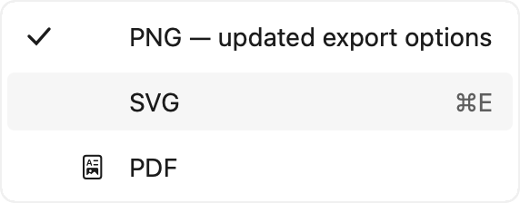

# MenuBar、共享 Flyout 与右键菜单更新生命周期复核

日期：2026-10-31。接续 `0dc4cda`；开始时工作区干净。前一批 CommandBar 的历史数据保持原样。

## 独立确认的问题

1. MenuBar 的 `synchronizeItems` 每次都先 `closeMenu()`。即使菜单内容完全不变，声明式刷新也会关闭根菜单和子菜单。两条新增测试在旧实现上出现 8 个失败断言，见 [`before/regression-tests.log`](before/regression-tests.log)。
2. 顶层菜单改变顺序时，原实现重建全部按钮，打开项身份丢失；展开导航回调又捕获初始索引，不能支撑原地重排。
3. 共享 Flyout、presenter 和菜单行都保存不可变菜单项，缺少更新标题、动作、状态、子菜单分支与尺寸的通道。
4. `FluentMenuBuilder` / `FluentMenuBarBuilder` 的 optional/array 分支返回数组，`buildBlock` 却只接受单项，条件菜单无法编译。旧 Release 库上的实际编译失败保存在 [`before/builder-compile.log`](before/builder-compile.log)。
5. 右键菜单包装层一直使用创建时捕获的正文更新闭包；已打开菜单也仍持有旧标题与动作，移除宿主后菜单未关闭。此项在共享 Flyout 修复后另行补充复现，旧包装层仍有 4 个失败断言，见 [`before/context-regression.log`](before/context-regression.log)。

6. 收尾输入复核发现，菜单已关闭后，旧 presenter 仍可执行排队的点击；新增测试实际触发了 1 次本不应发生的动作，见 [`before/queued-click-regression.log`](before/queued-click-regression.log)。关闭时现在使旧 presenter 失效，也阻止旧窗口的 Escape 关闭重新打开的菜单。

## WinUI 依据

本地参考：`microsoft-ui-xaml-winui3-release-2.3.1/src/controls/dev/MenuBar/MenuBarItem.cpp`。

- `OnItemsVectorChanged`（230–249 附近）直接向现有 Flyout 的 Items 插入／删除项目，并不先隐藏整个菜单。
- `ShowMenuFlyout` / `OnPresenterKeyDown` 保留空菜单不打开、子菜单先处理展开方向键、其余水平导航交由 MenuBar 的行为。
- `MoveFocusTo` 与展开状态的 `FocusAndReturnNextFocusableItem` 行为不同：关闭状态尝试相邻顶层项，展开状态跳过不可聚焦项并循环。本批保留原有区别，没有将两者统一改写成跳过禁用项。

Swift 构建器与右键包装层的问题是 FluentKit 自身 API／更新缺陷，不是对 WinUI 源码语法的映射。

## 修改结果

- MenuBar 按现有 `FluentMenuBarItem.id` 复用顶层控件；打开项重排后跟随自己的新索引，悬停与导航回调不再捕获旧索引。移除、禁用、清空打开项以及移除 MenuBar 宿主时关闭对应菜单。
- 新增可选 `FluentMenuItem.id`、带 ID 的 submenu/separator 构造，以及 `FluentMenuFlyout.update(items:theme:reduceMotion:)`。ID 在每个菜单层级内唯一；未提供 ID 时按位置保留行。顶层 MenuBar 原有默认 ID 仍取标题。
- 根菜单、presenter、保留的菜单行和仍有效的子菜单分支原地更新；保留键盘选中项与最新动作。删除／禁用选中项后选择可用目标，失效的子菜单分支关闭，但不无故关闭根菜单。
- 延迟悬停通过保留的行身份定位当前索引；重排后打开正确分支，删除后的旧回调不会打开占据原位置的新行。已移除行的异步点击不再触发动作。
- 菜单几何随内容、字号、锚点和 FlowDirection 更新。改变大小时复用前一批的 `settlePresentation()` 更新共享动画裁剪区域。单纯移动锚点不重新更新全部行内容。
- 菜单行原地更新图标／勾选占位、pill、标题、快捷键说明、启用状态和可访问性元数据；当前菜单打开时采用的触摸／鼠标密度保持不变。
- 两个结果构建器支持 `if`、循环、数组和空分支，并保留原有单项 `buildBlock` 重载。
- 右键菜单刷新采用新的正文更新闭包与菜单内容；宿主移除时关闭菜单。共享 Flyout 释放时也从父窗口移除自身。
- 新增 [MenuBarGallerySample.swift](../../../FluentKitGallery/FluentKitGallery/MenuBarGallerySample.swift)：点击 “Refresh in 2 seconds”，在延时更新前打开 File › Export，可观察菜单重排、内容增添、勾选与最新命令动作。Gallery 目录现在提供直接示例，覆盖状态仍保留 Partial。

## Release 原始复现与渲染检查

探针在浅色／深色 × LTR／RTL 下，依次记录打开、5 次无变化刷新、子菜单内容更新、顶层重排、运行时方向切换，共 **20 个状态**。源文件为 [`MenuLifecycleAudit.swift`](MenuLifecycleAudit.swift)，断言见 [`check_results.py`](check_results.py)。

| 检查 | 旧 Release 库 | 修复后 |
| --- | --- | --- |
| 5 次相同内容刷新后 | 根菜单和子菜单均关闭 | 原根窗口、子窗口均保留 |
| 刷新后保留的根菜单行 | 0/2 | 2/2 |
| 原 SVG 子项、键盘选中状态 | 原子项已不在已打开菜单中 | 原行与选中状态保留 |
| 增添 PDF、更新 PNG 标题／勾选 | 已关闭，未显示更新 | 同一子窗口更新为 3 行 |
| 顶层 File 重排 | 控件重建、打开索引丢失 | 原控件保留，打开索引 0 → 1 |
| 方向切换和动画裁剪 | 菜单已关闭 | 两层菜单镜像并完整显示 |

数据：[`before/results.json`](before/results.json)、[`after/results.json`](after/results.json)。基线复用上一批生成的 Release 库；库对象 SHA-256 各自保存在 `library-sha256.txt`。基线有 28 张 PNG，最终有 60 张：旧版刷新后菜单关闭，所以后续没有菜单窗口截图。

图像均由实际 AppKit view/layer 树直接渲染为 2× PNG。人工查看动态增项、勾选／图标占位、RTL、选中背景与快捷键布局。另逐字节比较：

- 四种外观方向中，首次打开的工具栏、根菜单、子菜单 **12 对** PNG 与修复前完全一致。
- 修复后，相同内容刷新五次前后的工具栏、根菜单、子菜单 **12 对** PNG 完全一致。
- 所有 20 个状态的两层动画 mask 均覆盖当前窗口区域；没有沿用旧尺寸而截掉新增行。

示例：




这些结果证明本地 macOS 渲染与更新行为；不等于 Windows 截图对拍。

## 验证

- **288 项 XCTest、0 失败**（新增 12 项）；开启 warnings-as-errors。
- XCTest 与原生验证日志通过 AppKit 约束冲突检查。
- `FluentKitValidation` 通过。
- Release 质量门禁通过，覆盖更新次数、挂载、外部重置、字体、材质与 **61 个直接 Gallery 示例**的浅色／深色／RTL 挂载。
- Xcode Gallery Debug 构建通过，关闭签名。
- 20 状态 Release 探针及裁剪几何检查通过，60 张最终截图保存在 `after/images/`。

测试覆盖：相同内容更新、最新动作、顶层及嵌套 ID 重排、子菜单保留、禁用／删除分支、空菜单和宿主移除、设备密度、图标／勾选状态增删、锚点移动、RTL 切换、延迟悬停失效、结果构建器、右键正文与动作更新、实时字号变化、关闭后的排队点击与旧窗口键盘事件。原始测试和构建日志位于 `after/`。

环境：macOS 27.2（26B123），Apple Swift 6.4，Swift 5 language mode。复跑：

```sh
swift test --scratch-path /tmp/fluentkit-repair-tests -Xswiftc -warnings-as-errors
./audits/2026-10-31/menubar-lifecycle/run.sh /tmp/menubar-lifecycle-review
./tools/run-quality-checks.sh /tmp/fluentkit-quality-review
```

## 继续保留的工作

- 新的 live-update 通道已接入 MenuBar 与声明式右键菜单；其他 Flyout 消费者（例如 SplitButton、AppBarButton）仍需逐个复核其配置更新和交互流程，不能据此声称所有菜单消费者已完成。
- 长菜单滚动和完整 WinUI 键盘／指针细节继续专项复核；AutoSuggestBox、SplitButton 仍在后续打磨范围。
- Windows 逐像素对照、真实触摸、IME 与 VoiceOver 仍未验收。触摸行高测试使用记录的设备类型，键盘测试通过 AppKit 合成事件，不冒充实机验收。
