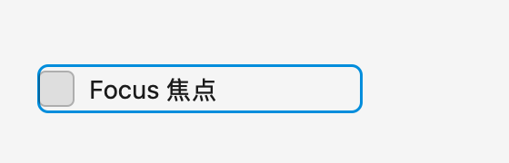
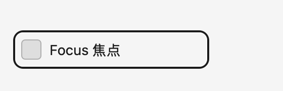

# CheckBox / RadioButton 焦点视觉复核

基线 `79a8c82`。本批修复选择控件的默认 HighVisibility 焦点几何、颜色及控件自身裁剪，并核查上一批留下的模型同步回写和 FocusPress 假设。所有源码对照使用本地固定的 WinUI 3 release 2.3.1，文件哈希见 `winui-sources.json`。

## 源码依据与修复

1. `CheckBox_themeresources.xaml` / `RadioButton_themeresources.xaml` 使用系统焦点视觉，边距为 `-7,-3,-7,-3`。`CommonStylesTests.cs` 验证主边框 2pt、次边框 1pt。原 CheckBox 是控件内部的单层 accent 边框；现在使用外侧双层边框。
2. `FocusRectManager.GetFocusOptionsForElement` / `ConfigureFocusElement` 先调整圆角，再将次边框向内移动主边框的厚度。`geometry.cpp` 的 `CalculateRoundedCornersRectangle` 以边框中心线圆角计算内外轮廓。原 RadioButton 将边框外缘直接当描边中心，四边多伸出 1pt，且圆角调整量错误。现在主边框中心内移 1pt，次边框中心内移 2.5pt；默认中心线圆角分别为 9pt、7pt。零圆角保持方角。
3. `Common_themeresources_any.xaml` 的标准配色为深色白色主边框/半透明黑色次边框，浅色为半透明黑色/白色。高对比度采用系统窗口文字和背景角色，在明确的 Fluent 深浅色下解析后转为 CGColor。这里是 AppKit 颜色角色映射，不是 Windows 系统颜色的逐像素采样。
4. **首轮修复曾让 CheckBox 焦点框消失。** 原生数据证明：设置 CALayer 不裁剪仍不足；设置 backing layer 的 `cornerRadius` 会重新启用 NSView 裁剪。最终在更新圆角后显式设置 `clipsToBounds = false`。同一原生诊断在修改圆角前后记录了 `false → true`，见 `after/clip-diagnostic-2.log`。两类控件均明确声明自身允许外侧焦点边框。[Apple 的 clipsToBounds 文档](https://developer.apple.com/documentation/appkit/nsview/clipstobounds)说明此属性控制绘制裁剪，并不扩展命中区域。

几何和颜色计算由内部 `FluentChoiceFocusVisual` 共用。选择、绑定、键盘提交逻辑未在此批改变。

## 不能直接按“缺陷”处理的两项

**默认模式不应补上 Reveal 的按压动画。** `FrameworkApplication_Partial.cpp` 默认选择 HighVisibility；`FocusRectManager.OnFocusedElementKeyPressed/Released` 仅在 Reveal 模式下调用动画器。因此普通键盘按下/释放时维持焦点边框，不给整个焦点框添加缩放动画。当前 API 未提供完整 Reveal 模式。

**RadioButtons 同步纠正模型的现象已复现，但不能简单声称它偏离 WinUI。** 探针点击 B，模型观察者立即改为 C，结果模型为 C、界面仍选 B；再次发布 C 后界面与事件才跟上。固定版本的 `RadioButtons.Select` 明确防止选择重入，普通 `BindingExpression.SourceChanged` 也忽略 SettingSource 期间的通知。此处保留现状及原始记录 `native/reentrancy-observation.json`，没有以新的自动重放策略代替上游语义。不同绑定机制及实际 Windows 上的事件顺序仍需实测；同步归一化契约保持开放。

## 验证

- 同一套最终 4 项测试在旧代码上有 63 处断言失败，涵盖双边框、边距、圆角、RTL、宽度变化、显式主题、高对比度、方角及焦点状态；原始日志 `before/tests.log`。
- 独立原生探针覆盖直接控件及声明式绑定宿主、深浅色、标准/高对比度、按下/释放、缩放、禁用、失焦，共 96 个状态。旧版有 1,260 项字段偏差（包括逐颜色通道计数）；修复后归零，见 `comparison.json`。
- 对 1×/2× 原生层渲染图另采样焦点外侧、两行主边框及一行次边框，共 128 个像素位置，原 104 处像素偏差修复后归零，见 `pixels.json`。这一步用于发现路径正确但实际被裁剪的情况。
- 最终 433 项测试全过、无 AppKit 约束诊断，Gallery 构建、原生验证和 Release 质量门禁通过；日志均在 `after/`。
- 实际 Gallery 的隔离副本通过 CUA 到达 CheckBox 页面，但 Tab 在侧栏 Settings 停住，未进入示例。坐标点击返回 `AXError.notImplemented`，因此此批不能声称通过了实际 Gallery 的键盘焦点视觉验收。复现记录见 `after/gallery-ui.md`；焦点链另列为紧接着处理的问题，原因尚未确定。

旧版与修复后的浅色 CheckBox：




首轮补丁、裁剪诊断、4 处失败及 48 个被裁剪的原生状态保留在 `after/initial-runtime.patch`、`after/tests-initial.log`、`after/native-initial/`。只在初始化时关闭 NSView 裁剪仍不足，第二次失败日志/补丁也保留；最终在圆角更新之后处理。修复前后使用相同测试和原生预期。

## 复现与边界

```sh
swift test --scratch-path /tmp/fluentkit-repair-tests -Xswiftc -warnings-as-errors --filter ChoiceFocusTests
swift build --target FluentKit -c release --scratch-path "$TMPDIR/fluentkit-quality-release" -Xswiftc -warnings-as-errors
zsh audits/2026-11-01/choice-focus/run-probe.sh after
python3 audits/2026-11-01/choice-focus/check-results.py
python3 audits/2026-11-01/choice-focus/check-pixels.py
```

旧版探针须通过 `FLUENTKIT_FOCUS_PRODUCTS` 指定 `79a8c82` 的 Release 产品。脚本会写入对应阶段目录；历史比较请在单独 checkout 复现。像素脚本使用 Pillow。

本批验证普通控件及绑定包装层的焦点输出，未实现 WinUI 完整的焦点浮层宿主、祖先裁剪边缘处的自动挪入（nudging）、Reveal、跨控件焦点过渡。真实 Windows 对拍、VoiceOver、触摸和实际 IMK 候选定位仍开放。未安装、替换或停止正在运行的 Fluent IME。
