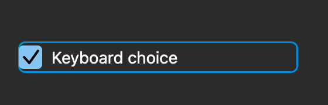
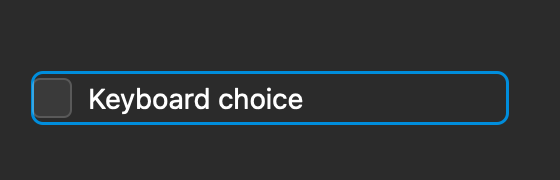

# CheckBox / RadioButton 输入与绑定交错

基线为 `8be10b5`。本批修复 CheckBox 的 Space 提交时机、Enter 行为、数字键盘选择、按压取消，以及选择控件的绑定更新/换绑与输入手势交错。原始审计和其他开放项继续保留。

## WinUI 对照

固定源码位于 `microsoft-ui-xaml-winui3-release-2.3.1/src`，本批读取文件的 SHA-256 见 `winui-sources.json`。

- `dxaml/xcp/components/controls/KeyDownUp/inc/ButtonBaseKeyProcess.h`：默认 Release 模式在 Space 按下时设置 Pressed，释放时触发 Click；按住期间不重复触发。鼠标已捕获时 Space 不接管；Space 先按下又按鼠标时，要考虑两者的释放顺序。
- `dxaml/xcp/dxaml/lib/CheckBox_Partial.cpp`：初始化关闭 Enter 激活；二态模式的数字键盘 Add/Subtract 分别设置选中/未选中。
- `ButtonBase_Partial.cpp` 的 `OnLostFocus`、`ClearStateFlags`、`OnPointerPressed`、`OnPointerReleased`：失焦/禁用/隐藏需要清状态，指针与键盘按压具有独立状态。取消键盘按压时，已有指针捕获仍可继续处理后续拖动。
- `DependencyObject.cpp` 的 `SetBindingCore` / `FrameworkElement_partial.cpp` 的 `SetBinding`：替换绑定表达式没有取消 ButtonBase 输入的步骤；结合 ButtonBase/ToggleButton 的属性处理，同一控件更换绑定后仍应在释放时使用当前值和当前绑定。
- `ToggleButton_Partial.cpp` 的 `OnIsCheckedChanged` / `OnToggle`：属性变化本身不取消输入；点击时读取当前 IsChecked 再切换。旧版原生直接赋值已如此，绑定适配器额外取消手势，造成两条路径不一致。

## 根因及修改

1. **CheckBox 在 Space/Enter keyDown 直接翻转。** 现在 Space keyDown 只进入 Pressed，keyUp 提交；Enter/数字键盘 Enter 不切换，键盘 Add/Subtract 支持显式选择。键盘 Pressed 不再依赖鼠标悬停。
2. **视觉 Pressed 和捕获混用，失焦/移除后仍可能提交。** CheckBox 分开记录 Space、指针按压和视觉状态。两种控件均在移除、失焦、禁用、隐藏（包括祖先隐藏）、窗口失活时取消输入，并移除旧窗口通知订阅。AppKit 的 [`viewDidHide()`](https://developer.apple.com/documentation/appkit/nsview/viewdidhide%28%29) 同时通知自身隐藏和祖先隐藏。
3. **绑定改值不应隐式取消按压。** 数值更新现在保留手势，释放操作使用最新值；同一控件实例替换绑定仍保留手势，释放使用当前绑定。旧订阅必须隔离，但不能把换绑本身当成取消输入的条件。
4. **旧观察者排队的回调覆盖新绑定，或旧值覆盖较新的值。** CheckBox/RadioButton 主线程更新改为同步；回调检查订阅代次和当前模型值。RadioButtons 同样丢弃过期选择，绑定刷新和替换都保留按压。
5. **Space 与指针共同按住时过早提交。** Space 先按下时，先释放其中一个不提交，最后释放才提交一次；无关键取消 Space 后，已有指针捕获仍能通过后续拖动恢复按压。指针移动不会覆盖仍由 Space 维持的 Pressed。

行为变化已记入 CHANGELOG。这些改动不改变文本编辑器/IME 的外部重置策略。

## 证据

| 范围 | 基线 `8be10b5` | 修复后 |
| --- | --- | --- |
| 同一套最终 11 项测试 | 41 处断言失败 | 0 |
| 同一套 92 个原生状态 | 46 个状态、50 项字段偏差 | 0 |
| 全量测试 | 原 418 项 | 429 项全过，无 AppKit 约束诊断 |
| 原生验证、Gallery 构建、Release 质量门禁 | 旧验证包含相反的绑定取消断言 | 均通过 |

最终用例覆盖正常/重复 Space、Enter、数字键盘、失焦/移除/失活/禁用/隐藏、外部改值、同实例换绑、旧观察回调、同源过期选择、RadioButtons 组内更新及 Space/指针组合。最终测试文件复制到旧基线后重跑，日志为 `before/tests-corrected.log`；当前全量日志为 `after/tests-corrected.log`。两侧测试/探针哈希一致。

**中途撤回过一条错误策略。** 首轮补丁把换绑也当成取消输入，相关测试和 76 状态探针也有相同错误预期。继续核对 `SetBindingCore` 后撤掉该策略、修正预期，并用最终 11 项和 92 状态重新跑两侧。因此首批 10 项的“32 处失败”不能作为最终修复依据。旧测试、日志、预期和哈希保留，`native.log-superseded-oracle`、`native-superseded-oracle/` 及 `provenance-before-binding-review.json` 明确标注为被替代的版本。旧 76 状态探针还原为 `ChoiceAudit-superseded-oracle.swift`，SHA-256 与原记录一致。初次旧基线命令因测试文件尚未进入构建计划而执行了 0 项，日志 `tests-discovery-initial.log` 也不计入证据。

组合输入在首次补丁上另复现过 4 处失败，见 `after/mixed-input-initial.log`；对应首轮运行时补丁保存在 `after/initial-runtime.patch`。这些历史记录说明测试通过后仍需继续核对行为，并非最终版本结果。

原生探针使用公开控件/声明式更新 API，在独立窗口中采集深浅色下的 Space、Enter、数字键盘、指针/键盘取消、外部改值和换绑。窗口失活用的是明确投递的 NSWindow 通知，不把这一项称为操作系统实机切换。`comparison.json` 保存逐字段差异，原始数据和 2× layer 渲染图在两侧 `native/`。最初的 56 状态采样先扩展到 76，最终加上自身/祖先隐藏的键盘与指针取消，共 92 状态；历史数据均保留。

下面分别为旧版 Space 按下、最终版 Space 按下、最终版释放后的真实层渲染：





另通过 CUA 在最终构建的独立窗口中聚焦并发送按键。`KeyboardWindow.sendEvent` 记录事件分发前后状态，结果在 `after/keyboard-events.json`：

- 两次 CheckBox Space 和一次 RadioButton Space，keyDown 前后值不变，3 次 `valueChanged` 均发生在 keyUp（事件类型 11、键码 49）。
- Enter（36）不切换两种控件。
- 数字键盘 Add/Subtract 在 keyDown（10）分别以键码 69/78 设置选中/未选中。

这是经真实 NSWindow 的工具键盘事件验证，不是物理键盘延迟或 VoiceOver 验收。最终源码重建后复验，二进制/库/日志哈希见 `after/keyboard-provenance.json`；此前日志分别保存在 `keyboard-events-first-pass.json` 和 `keyboard-events-before-binding-review.json`。

## 原生验证断言的修正

`FluentKitValidation` 原先要求外部 CheckBox 改值取消 Pressed，且要求 Space keyDown 已提交。它会让不符合 WinUI 的实现被判为通过。本批将其改为最新值释放提交、Space keyDown/keyUp 分开验证，并在 RadioButton 外部更新后检查 10pt 的 Pressed 内圆几何。原失败保留在 `after/native-validation-initial.log`，最终验证通过。

## 最终门禁记录

- 全量 429 项：`after/tests-corrected.log`；无 AppKit 约束诊断。
- 原生验证通过：`after/native-validation-corrected.log`；Gallery 构建通过：`after/gallery-build-corrected.log`。
- Release 门禁通过：`after/quality-corrected.log` 和 `after/quality/`。
- 一次门禁首个输入采样与前一原生验证末尾重叠约 0.9 秒，已弃用并串行重跑两者；保留在 `*-overlap-discarded*`，不作最终性能依据。

## 复现

```sh
swift test --scratch-path /tmp/fluentkit-repair-tests -Xswiftc -warnings-as-errors --filter ChoiceInputTests
swift build --target FluentKit -c release --scratch-path "$TMPDIR/fluentkit-quality-release" -Xswiftc -warnings-as-errors
zsh audits/2026-11-01/choice-input/run-probe.sh after
python3 audits/2026-11-01/choice-input/check-results.py
zsh audits/2026-11-01/choice-input/build-keyboard.sh
```

键盘应用生成于 `/tmp/Fluent Choice Keyboard.app`。旧版探针使用 `8be10b5` 的 Release 库，可通过 `FLUENTKIT_CHOICE_PRODUCTS` 指定产品目录。重跑会写入阶段目录；保留历史数据时请另开 checkout。最终源码/测试/探针哈希在 `after/provenance.json`，旧版哈希在 `before/provenance.json`。

## 后续

- CheckBox 目前仍是 accent 单层焦点边框；WinUI 使用系统焦点视觉及 `CheckBoxFocusVisualMargin`，还涉及 `FocusPressState`。本批不声明焦点视觉和动画已完全对齐。
- 继续复核 RadioButtons 外部观察者同步归一化选择的重入行为，以及原生组位置描述、内圆描边、独立三态 API、AnimatedIcon。
- 混合手势中的物理设备时序、Windows 逐帧/逐像素、真实 VoiceOver/触摸与实际 IMK 候选定位仍开放。未安装、替换或停止运行中的 Fluent IME。
