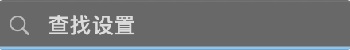

# 输入框圆角裁切、宽度与禁用状态

2026-11-01。FOLLOW-UP 第 4 项的独立复核。两个可复现问题已修复；保留旧版本原始数据。

## 结论

三个 Fluent 输入控件仍继承 AppKit 左右各 2pt 的 `alignmentRectInsets`，同时用整个 `bounds` 绘制自己的背景和边框。因此 Auto Layout 分配 220pt 时，控件实际是从 −2pt 开始的 224pt。放入会裁切的容器后，两侧弧线被截掉，4pt 圆角看起来变方；焦点底线两端也被切平。

最小复现为 `FluentNativeView(field).frame(width: 220, height: 32).background(.clear)`。直接设置裸控件 frame 时没有这次 Auto Layout 扩宽，能说明为什么只检查单控件截图会漏掉问题。TextField、SearchBox、SecureField 均受影响。

修复为这三个自绘控件清除原生 bezel 的布局补偿，使其可见边界、命中边界与分配的 frame 一致。绘制算法和默认圆角大小保持现有值。

另一个独立缺陷：SearchBox、SecureField 没有普通 TextField 已有的 `isEnabled` 外观同步，禁用后保留了旧占位文字属性。直接渲染原生 cell 证明文字确实没有变淡。补上同步后，禁用和重新启用都立即更新。

| 验证 | 修复前 | 修复后 |
| --- | --- | --- |
| 32 个容器内状态的额外宽度 | 全部 +4pt | 全部 0pt |
| 聚焦状态的裁切角点 | 弧线被截断，角点不透明 | 1×/2× 的四角保留透明区 |
| 实际 IME 普通窗口搜索宽度 | 声明 310 / 实际 314pt | 310 / 310pt |
| 实际 IME 窄/宽窗口搜索宽度 | 274 / 484pt | 270 / 480pt，与声明一致 |
| 深色 Search/Secure 禁用占位字形最大 alpha | 0.773，未变化 | 0.365 |
| 浅色 Search/Secure 禁用占位字形最大 alpha | 0.620，未变化 | 0.361 |
| 两项新回归测试 | 40 处断言失败 | 全部通过 |

裸控件与容器内控件、深浅色、两种宽度、Normal/Hover/Focused/Disabled/重新启用/再聚焦/失焦共 64 状态，每状态输出 1×/2×。所有状态均没有开启原生 bezel、边框或背景，排除了本轮“聚焦重新打开原生边框”的假设。`comparison.json` 保存像素角点与宽度统计。

修复前后焦点态：




## WinUI 依据与实际应用

- [Microsoft 圆角说明](https://learn.microsoft.com/da-dk/windows/apps/design/style/rounded-corner)：普通输入控件默认 4 个逻辑像素，浮层通常 8；相接边另有规则。
- [AutoSuggestBox 模板](https://github.com/microsoft/microsoft-ui-xaml/blob/main/controls/dev/AutoSuggestBox/AutoSuggestBox_themeresources.xaml)：内部 TextBox 继承外层 CornerRadius，建议浮层使用独立的 OverlayCornerRadius。
- [公共输入资源](https://github.com/microsoft/microsoft-ui-xaml/blob/main/controls/dev/CommonStyles/Common_themeresources.xaml)及 [TextBox 模板](https://github.com/microsoft/microsoft-ui-xaml/blob/main/controls/dev/CommonStyles/TextBox_themeresources.xaml)：普通边框 1，常规深浅主题聚焦为 1,1,1,2。FluentKit 本轮样本的半径为 4pt、焦点底线为 2pt。

`settings-before/` 与 `settings-after/` 使用实际 IME 设置源码和相同 Core，应用源码哈希相同。记录包含所有祖先的 bounds、裁切标志、原生 alignment insets、搜索 editor 与 marked text；输入触发页面更新、组合期间缩放仍保留同一实例及内容。当前标题栏祖先没有显式裁切，不能仅凭用户截图逆推出当时已安装程序的完整宿主版本；本轮明确证明的是框架的可复现裁切缺陷，以及实际 IME 的 4pt 宽度偏差已消除。

另将同一实际设置源码编译为独立测试 App，通过电脑界面检查失焦和聚焦状态：搜索文字位置稳定、四角与底线完整。测试进程已关闭。没有安装、替换或终止用户的输入法，也没有修改 IME 源码。

## 验证与边界

379 项测试、原生验证、Gallery Debug 构建与 Release 质量门禁通过；测试日志无约束诊断。原始两项回归测试在修改前 `6eb6ca2` 的代码上失败，修复后与上一批字形对齐测试一起通过。

本批的公开行为变化是：三个自绘输入控件通过 Auto Layout 布局时不再额外扩宽 4pt。手工设置裸控件 frame 的行为不变。已有分配宽度包含原生补偿的应用应按可见尺寸检查。

未编辑的原生 cell 内容可能不出现在 layer 采样中；透明背景图也不能当作最终合成颜色。圆角/边界检查使用实际宿主 layer，禁用文字检查单独直接渲染 cell，并以真实窗口查看补充。不是 Windows 像素对拍或物理 IME/VoiceOver 验收。AutoSuggestBox 建议浮层与实际组合候选窗在下一项继续检查。

## 复现

```sh
./audits/2026-11-01/search-chrome/run.sh /tmp/search-chrome-review
./audits/2026-11-01/search-chrome/run-disabled.sh /tmp/search-chrome-review
swift test --scratch-path /tmp/fluentkit-repair-tests --filter TextInputChromeTests
python3 audits/2026-11-01/search-chrome/check_results.py
./audits/2026-11-01/search-chrome/run-settings.sh /tmp/settings-chrome-review
```

实际 IME 探针需要当前应用对应的 FluentIMECore，准备方式同 `../search-geometry/REPORT.md`。`FLUENTKIT_SEARCH_LIBRARY` 可指定旧对象。基线 Release 对象 SHA-256 为 `0622a27ea1ded0e3991f23e1f5901776708377c3104dcd05ce6e4fa627061108`。`before/` 是最初裸控件的探索数据；最终相同探针对照为 `baseline/`、`after/`。
